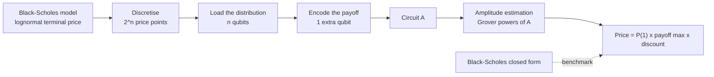

# The circuit

How `qae_european` turns a European call price into a quantum circuit, and how amplitude estimation reads the price out. Results and tests are in [results.md](results.md).

## At a glance

The circuit A has n + 1 qubits: n "price" qubits that hold the distribution, and one "objective" qubit whose probability of reading 1 is proportional to the expected payoff. Amplitude estimation then estimates that probability with fewer calls of A than plain sampling needs.

## Step 1: discretise the distribution

Under Black-Scholes, the log of the terminal price is normal with mean m = ln S₀ + (r − σ²/2)T and standard deviation s = σ√T (`classical.discretise`).

- The log-price range m ± 4s is cut into 2ⁿ equal bins.
- Each bin i gets its probability pᵢ (renormalised so that they sum to one).
- Each bin is represented by the conditional mean of the price inside it, xᵢ = E[S_T | S_T in bin i]. For a lognormal this is exact in closed form. It keeps the discretised forward equal to the true one, so the only error left comes from the bin that straddles the strike.

## Step 2: load the distribution (n qubits)

The price register is prepared in the state

$$|\psi\rangle = \sum_{i=0}^{2^n-1} \sqrt{p_i}\,|i\rangle$$

so that measuring it returns price point i with probability pᵢ. The kit uses Qiskit's exact `StatePreparation`. It is the simplest correct choice, and it is also the part that does not scale (see the limits below).

## Step 3: encode the payoff (1 objective qubit)

For each price point, a rotation of the objective qubit, controlled by the price register being in state |i⟩, sets

$$P(\text{objective} = 1 \mid i) = f_i = \frac{\max(x_i - K, 0)}{\max_j \max(x_j - K, 0)}$$

with the angle θᵢ = 2 arcsin √fᵢ. Points where the option ends out of the money get no rotation. Over the whole register:

$$a = P(\text{objective} = 1) = \sum_i p_i f_i = \frac{E[(S_T - K)^+]}{\text{payoff}_{\max}}$$

so the price is e^{−rT} · payoff_max · a.

The circuit A for 3 price qubits (8 points). The state preparation box loads √pᵢ; each controlled R_Y rotation encodes the payoff of one in-the-money point, and the X gates select which basis state controls it:

## Step 4: read the probability

The kit reads a three ways (`circuit.py`):

| Method | How | Error for N calls |
| --- | --- | --- |
| Exact | Probability from the simulated statevector | None: checks the circuit |
| Sampling | Measure the objective qubit N times | ∝ 1/√N, like Monte Carlo |
| Amplitude estimation | Measure after k Grover steps, for several k | ∝ 1/N |

**The Grover operator.** With a = sin²θ, the operator

$$Q = A\,S_0\,A^\dagger\,S_\chi$$

(S_χ flips the sign of states with objective = 1, S₀ flips the sign of |0…0⟩) rotates the state by 2θ. After k applications, the objective qubit reads 1 with probability sin²((2k + 1)θ). The angle is amplified by 2k + 1: that amplification is where the speed-up comes from.

**Maximum-likelihood amplitude estimation** (Suzuki et al., 2020). For a ladder of powers k ∈ {0, 1, 2, 4, 8, 16, 32}, the kit runs A followed by k steps of Q, measures the objective qubit 200 times, and records the number of ones hₖ. The estimate of θ maximises the likelihood

$$L(\theta) = \prod_k \left[\sin^2((2k+1)\theta)\right]^{h_k}\left[\cos^2((2k+1)\theta)\right]^{200-h_k}$$

Each measurement after k steps costs 2k + 1 calls of A. This variant needs no quantum phase estimation, which keeps the circuits shallow.

## Code map

| File | Content |
| --- | --- |
| `classical.py` | Option parameters, Black-Scholes closed form, discretisation, discretised price, plain Monte Carlo |
| `circuit.py` | `build_a` (the circuit A), `grover` (Q), `price_exact`, `price_sampled`, `price_mlae` |
| `resources.py` | Gate counts after compilation, calls needed for a target accuracy |
| `tests/test_kit.py` | Acceptance tests, criteria stated in advance |
| `docs/make_figures.py` | Rebuilds the figures and numbers in the docs |

## Design choices

- **Exact state preparation and one rotation per point.** They are the most readable construction, and correct by inspection. Their cost grows exponentially with n, which makes them a teaching device, not a production method.
- **A simulator with exact probabilities.** The sampling and amplitude-estimation results draw measurements from the exact probabilities, so they show the statistical behaviour without hardware noise.
- **Stable Qiskit APIs only** (`QuantumCircuit`, `StatePreparation`, `RYGate.control`, `Statevector`), so the kit runs with any Qiskit 1.x or 2.x.

## Limits

- **Loading does not scale.** Exact preparation of a 2ⁿ-point distribution needs on the order of 2ⁿ gates, and so does the payoff encoding. Efficient alternatives exist for some distributions (Vazquez and Woerner, 2021), or replace the explicit encoding (Stamatopoulos and Zeng, 2024).
- **No noise.** Real devices add errors that grow with depth; the deepest circuit here (32 Grover steps) would not run reliably on today's hardware.
- **Closed form available.** A European call needs no simulation at all: it is the benchmark, chosen so that every number can be checked.
