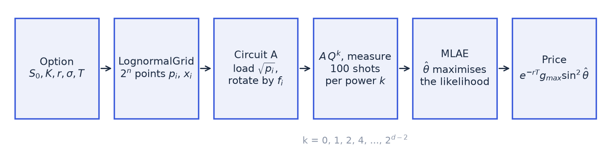
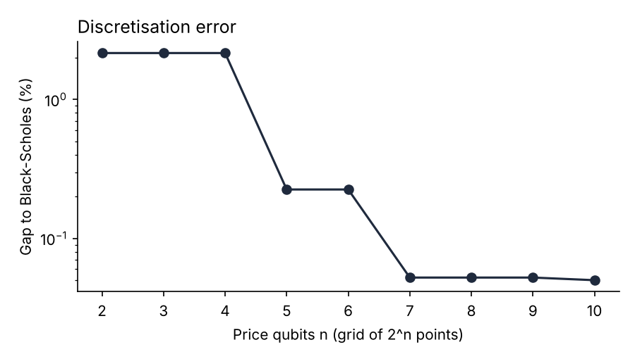
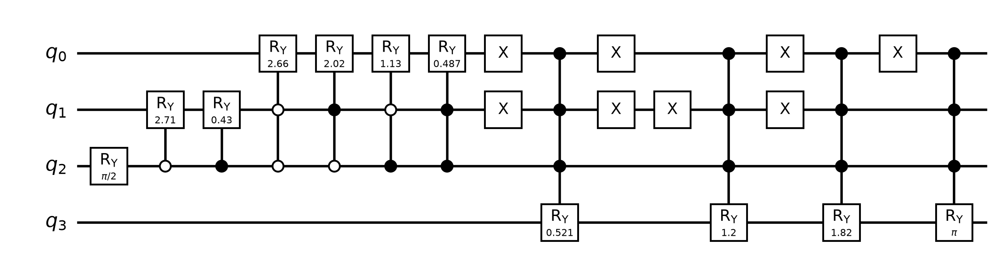
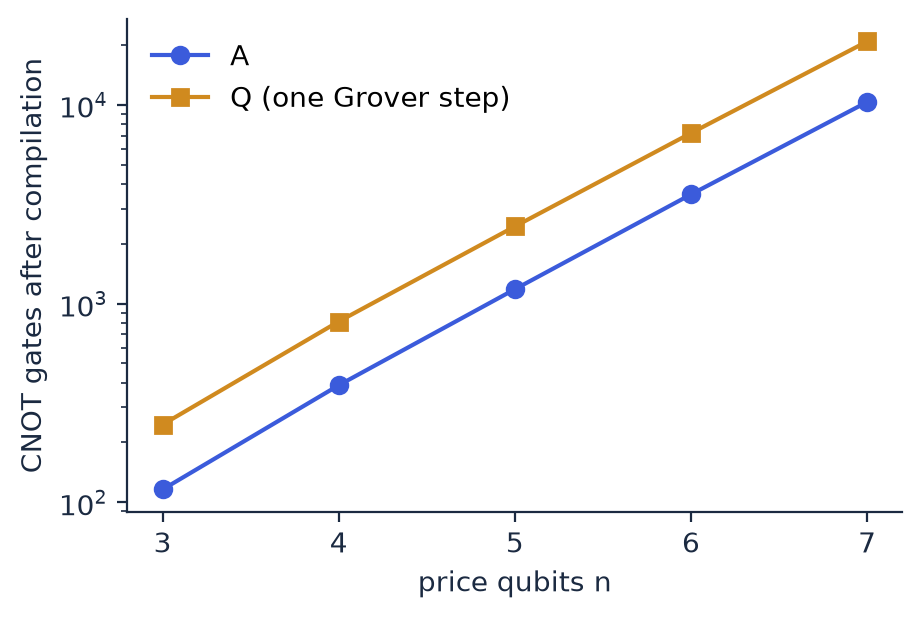

# Document 1: Circuit

**Kit:** qae_european 1.0.0 · **Scope:** what the circuit computes, how, with which inputs and outputs, and how to reproduce every number in the kit.

Companion documents: [Document 2: Benchmarks](benchmarks.md) · [Document 3: Tests](tests.md) · [User guide](../README.md).

---

## 1. Purpose

The kit prices a European call under Black-Scholes with **amplitude estimation** on a quantum circuit simulator. The aim is not to price this option (it has a closed form) but to provide the smallest complete example of the method: loading a distribution, encoding a payoff, estimating an amplitude, and validating the result against classical references.



## 2. Model and target

Under Black-Scholes, the terminal price is lognormal under the risk-neutral measure:

  ln S_T ~ N(μ, s²),  μ = ln S₀ + (r − σ²/2) T,  s = σ √T.

The target is the call price C = e^(−rT) E[max(S_T − K, 0)]. The underlying pays no dividend. Inputs are validated in `Option` (`option.py`): S₀, K, σ, T must be positive and finite; r must be finite and may be negative.

## 3. Discretisation (`grid.py`)

A circuit on n qubits holds 2ⁿ basis states, so the distribution is discretised on 2ⁿ points.

1. **Range.** The log-price interval [μ − w·s, μ + w·s] is cut into 2ⁿ bins of equal width in log-price, with w = 4 by default (`width`).
2. **Probabilities.** Bin i carries p_i = Φ(z_{i+1}) − Φ(z_i), with z the standardised edges. The probabilities are renormalised to sum to 1. The mass outside the range, 2Φ(−4) ≈ 6.3·10⁻⁵, is spread proportionally over the bins.
3. **Representative prices.** Bin i is represented by the conditional mean of S_T in the bin, which has a closed form for a lognormal:

   x_i = E[S_T | S_T in bin i] = e^(μ + s²/2) · [Φ(z_{i+1} − s) − Φ(z_i − s)] / p_i.

   Using conditional means rather than bin midpoints keeps, exactly, the part of the forward carried by the range. The part carried by the truncated tails is lost: the grid forward falls short of the true forward by a relative

   1 − [Φ(w − s) − Φ(−w − s)] / [1 − 2Φ(−w)],

   which is negligible for small s (0.002% for the reference option) but not for large s = σ√T: 0.39% at s = 1.34 (5 years, 60%) and 1.3% at s = 1.79 (5 years, 80%). For large s, most of the forward sits in the far upper tail of the distribution of ln S_T.

The **grid price** is P_grid = e^(−rT) Σ_i p_i max(x_i − K, 0). It is the exact target of the circuit. Its gap to Black-Scholes is the **discretisation bias**, which depends only on n, w and the option, not on any sampling.

**The bias has a floor.** As n grows, the bias falls, but only down to the **truncation bias**, set by w and s. Adding qubits does not remove it. Relative bias against Black-Scholes (`docs/truncation.py`, `results/truncation.json`):

| Option | s = σ√T | w = 4, n = 7 | w = 4, n = 14 (floor) | w = 6, n = 7 | w = 6, n = 14 |
| --- | --- | --- | --- | --- | --- |
| Reference option (K 105, 1Y, 20%) | 0.20 | −0.052% | −0.050% | −0.002% | −0.000% |
| At the money, 1Y, 80% | 0.80 | −0.23% | −0.21% | −0.030% | −0.000% |
| At the money, 5Y, 60% (scenario 1000) | 1.34 | −0.79% | −0.78% | −0.009% | −0.000% |
| At the money, 5Y, 80% | 1.79 | −2.15% | −2.14% | −0.073% | −0.002% |

**The width trade-off.** A wider grid removes the floor, but it raises the largest grid payoff g_max and therefore lowers the amplitude a the circuit must estimate (section 4). At n = 7, going from w = 4 to w = 6 multiplies g_max by about 2 for the reference option, 5 for the 1-year option at 80% and 14 to 35 for the 5-year options, and divides a by similar factors. The statistical error of amplitude estimation grows accordingly (section 11). A wider grid also needs more qubits for the same resolution: at n = 5, the reference option's bias is −0.23% at w = 4 but −1.8% at w = 6. The kit keeps w = 4 for every scenario; Document 3 states its results within that choice.



*Reference option of the guide: S₀ = 100, K = 105, r = 3%, σ = 20%, T = 1.*

## 4. The circuit A (`quantum.py`)

The circuit acts on **n + 1 qubits**:

- qubits 0 to n − 1: the **price register**. Basis state |i⟩ stands for grid point i, with qubit 0 the least significant bit (Qiskit's convention).
- qubit n: the **objective qubit**.

**Block 1: load the distribution.** `load_distribution` prepares Σ_i √p_i |i⟩ on the price register, with a binary tree of controlled RY rotations (Grover and Rudolph, 2002):

- Level 0 rotates the most significant qubit by 2 arcsin(√P₁), where P₁ is the probability that the index is in the upper half of the grid.
- Level l rotates qubit n − 1 − l, controlled on the l qubits above it, once for each of their 2ˡ states v. The angle 2 arcsin(√(P₁/P)) splits the probability P of the block of indices beginning with v into its upper half P₁ and its lower half.

That is 2ⁿ − 1 rotations, every angle computed directly from the grid probabilities. The loaded probabilities match the target to rounding error, 7·10⁻¹⁵ at n = 7 (`docs/checks.py`).

*History.* Up to the second campaign run, the kit used Qiskit's generic `StatePreparation`. Its synthesis is ill-conditioned:
- at n = 7, it loaded the probabilities with an error of 6·10⁻¹⁰;
- a relative change of 10⁻¹⁵ in its input moved its output by 3·10⁻¹⁰.

That made the H0-a criterion of Document 3 fail. The explicit loader replaced it on the recommendation of the independent review (Document 3, sections 1.9 and 2.4).

**Block 2: encode the payoff.** With g_i = max(x_i − K, 0) and g_max = max_i g_i, the normalised payoffs are f_i = g_i / g_max, in [0, 1]. For each grid point with f_i > 0, a rotation RY(θ_i) with θ_i = 2 arcsin(√f_i) is applied to the objective qubit, controlled on the price register being exactly |i⟩. The control on |i⟩ is built with X gates on the price qubits where bit i is 0, before and after a rotation controlled on all n price qubits. Grid points out of the money get no rotation.

After A, the state is Σ_i √p_i |i⟩ ⊗ (√(1 − f_i) |0⟩ + √f_i |1⟩). The probability of measuring the objective qubit in state 1 is therefore

  a = Σ_i p_i f_i = E_grid[g] / g_max,  and  P_grid = e^(−rT) · g_max · a.

The kit writes a = sin²θ with θ in [0, π/2]. If every grid point is out of the money (g_max = 0), the option is **worthless on the grid**: the price is exactly 0 and nothing is estimated.



*The first seven rotations are the loader: one on q₂, two on q₁ controlled by q₂, four on q₀ controlled by q₁ and q₂ (open circles: control on 0). The first is RY(π/2), because the grid is symmetric in log-price, so half of the probability lies in each half. Then four grid points are in the money, so A has four payoff rotations. The last one is RY(π), since f = 1 at the largest payoff.*

## 5. The Grover operator Q

  Q = A S₀ A† S_χ, up to a global phase of π, where:

- S_χ applies a phase −1 to states with the objective qubit in 1: a Z gate on qubit n.
- S₀ applies a phase −1 to |0…0⟩. It is built as X on all qubits, a multi-controlled Z (H, multi-controlled X, H on qubit n), then X on all qubits.

Q rotates the state by 2θ in the plane spanned by the "good" and "bad" components of A|0⟩. After A and k applications of Q:

  P(objective = 1) = sin²((2k + 1)θ).

The code sets the global phase of Q explicitly (`global_phase += π`). It has no effect on measured probabilities, but it makes Q equal to the textbook operator −A S₀ A† S_χ, which matters if Q is ever used under control.

## 6. Maximum-likelihood amplitude estimation (`estimation.py`)

Phase estimation would need many controlled applications of Q. MLAE (Suzuki et al., 2020) uses only plain circuits A Qᵏ and classical post-processing.

**Ladder.** A ladder of depth d uses the Grover powers k ∈ {0, 1, 2, 4, …, 2^(d−2)}: d powers, the largest 2^(d−2). Each circuit A Qᵏ is measured 100 times (`shots`).

**Cost.** One measurement after k steps applies A once, then Q k times. Each Q contains A and A†. The kit counts this as 2k + 1 applications of A (A† is counted as one application). The total cost of a ladder is

  N = shots × Σ_k (2k + 1).

With 100 shots, depths 4 to 8 give N = 1,800, 3,500, 6,800, 13,300 and 26,200 calls.

**Estimator.** With h_k ones out of `shots` at power k, θ maximises the log-likelihood

  L(θ) = Σ_k [ h_k ln sin²((2k + 1)θ) + (shots − h_k) ln cos²((2k + 1)θ) ].

It is maximised in two steps:

1. a grid search over equally spaced points on [0, π/2]: at least 4,001, and at least 200 per period of the most oscillating term (100 × m_max + 1 points, with m_max = 2k_max + 1);
2. a bounded scalar refinement (`scipy.optimize.minimize_scalar`, tolerance 10⁻¹²) within one grid step of each of the **5 highest local maxima** of the grid. The best refined point is kept.

Probabilities are clipped to [10⁻¹⁵, 1 − 10⁻¹⁵] to avoid log(0). The price estimate is e^(−rT) g_max sin²θ̂.

Why several candidates: when two peaks of the likelihood are nearly tied, the grid can rank them in the wrong order, because it samples each peak slightly off its top. Refining only the best grid point would then return the lower peak. An earlier version did exactly that. An internal review found it failed in about 1 draw in 200 at depth 8 and in every draw at depth 14 on the widest scenario. It was corrected before the campaign was re-run (Document 3, section 1.9). A unit test now compares the estimator with a 400,001-point grid at depths 8 and 12, and `docs/checks.py` does the same for every campaign configuration with a mode error. `Ladder.exponential` accepts depths up to 16.

**Known limitation: a heavy tail of large errors, worse at small amplitude.** L(θ) has many local maxima. The high powers make it oscillate quickly, and the low powers, which see only 100 shots each, are what tell the peaks apart. The noise in the low-power counts sometimes makes a wrong peak the highest one. The estimate then lands on a side peak, at a distance anywhere from a few standard deviations to a full period π/m_max.

*Measure 1: efficiency against the Cramér-Rao bound.* For this ladder, the Cramér-Rao bound on the standard deviation of θ̂ is

  1 / (2 √(shots × Σ_k (2k + 1)²)).

The Fisher information of one measurement after k steps is 4(2k + 1)², whatever θ. The campaign stores two quantities against this bound:
- the RMS error on θ, divided by the bound;
- the share of draws more than 4 bound standard deviations from the true θ.

At depth 8, the typical draw is efficient: the median ratio is 1.05. But 1.15% of draws are beyond 4 standard deviations, about 180 times what a Gaussian estimator would give, and up to 32% in the worst configuration. The tail is heavier when a is small (Document 3, section 2.9). It is what flattens the RMSE curve in Document 3, section 2.6.

*Measure 2: mode errors.* A draw counts as a mode error when |θ̂ − θ| > π/(2 m_max), half the period of the most oscillating term, which means it has jumped to another lobe. This catches only the largest errors (0.009% of draws at depth 8) and misses the side peaks inside a lobe. It is kept for continuity with the earlier runs. The threshold is also wide for short ladders (π/10 at depth 4), so the absence of mode errors at low depth is partly a consequence of the definition.

These errors are a property of MLAE with an exponential ladder, not of the optimiser: the estimate is the true global maximum of the likelihood (`docs/checks.py`; Document 3, section 2.9). A ladder or shot allocation that keeps the low powers informative at small amplitude, or a variant with a built-in confidence interval such as iterative amplitude estimation, would reduce them. The kit keeps the published method.

## 7. Simulating the measurements

Two backends give the measurement probabilities. On a noise-free simulator they are mathematically identical:

| Backend | How | Used for |
| --- | --- | --- |
| `statevector` | Builds A and Q in Qiskit and evolves the exact statevector through A Qᵏ, then reads P(objective = 1). | Verification, the user guide |
| `born` | Takes θ from the exact statevector of A, then uses P_k = sin²((2k + 1)θ). | The campaign (2.31 million amplitude-estimation estimates) |

In both cases, the measurement counts are then drawn as h_k ~ Binomial(shots, P_k). This is exactly what a noise-free sampler would return.

The `born` backend relies on the identity in section 5. It is checked by full statevector simulation on 20 scenarios drawn at random, for every number of qubits where the option is not worthless (`qae-european verify`, hypothesis H0-b of Document 3):

- for n ≤ 5, powers up to 64, which covers the full ladder of depth 8;
- for n = 6 and 7, powers up to 8, because simulation cost grows with the depth of A Qᵏ; plus the full ladder (powers up to 64) on the first of the 20 scenarios, so the largest circuits are also checked at the largest power the campaign uses.

The identity holds for any k: it follows from Q being a rotation. Document 3 reports the outcome.

## 8. Circuit size

Compiled to a hardware-like gate set {CX, RZ, SX, X} with Qiskit's transpiler (optimisation level 1, seed 0), for the reference option:

| Price qubits n | Qubits | CNOTs in A | Depth of A | CNOTs in Q | Depth of Q |
| --- | --- | --- | --- | --- | --- |
| 3 | 4 | 116 | 409 | 246 | 846 |
| 4 | 5 | 388 | 1,038 | 812 | 2,161 |
| 5 | 6 | 1,180 | 2,330 | 2,442 | 4,762 |
| 6 | 7 | 3,540 | 5,674 | 7,202 | 11,474 |
| 7 | 8 | 10,324 | 19,841 | 20,818 | 39,824 |

Depths can differ slightly between builds and Qiskit versions: an independent rebuild of the earlier circuit gave the same CNOT counts and depths within 0.2%.



The count roughly triples per added qubit, i.e. it grows exponentially. Both blocks are to blame:

- exact loading: 2ⁿ − 1 rotations, most of them multi-controlled;
- one rotation controlled on all n price qubits per in-the-money point.

The explicit loader costs about twice the CNOTs of Qiskit's generic synthesis at n = 7 (10,324 in A, against 5,000 in earlier versions). The kit chooses accuracy over size, because the circuit is simulated, not run.

At depth 8, one measurement at k = 64 applies Q 64 times: about 160,000 CNOTs for n = 5. That is far beyond today's noisy hardware, which is why the kit runs on a simulator. Efficient loading is the open problem for practical use (Vazquez and Woerner, 2021; Stamatopoulos and Zeng, 2024).

## 9. Inputs and outputs

### Inputs

| Input | Where | Type and range | Default |
| --- | --- | --- | --- |
| spot, strike, vol, maturity | `Option` | float > 0 | 100, 105, 0.20, 1.0 |
| rate | `Option` | float, may be negative | 0.03 |
| n_qubits | `LognormalGrid` / `QuantumPricer` | integer, 1 to 16 for the grid; at most 10 for the circuit | — (3 to 7 in the campaign; untested above 7) |
| width | `LognormalGrid` | finite float > 0, standard deviations | 4.0 |
| depth, shots | `Ladder.exponential` | depth: integer, 1 to 16; shots: integer ≥ 1 | — , 100 |
| powers, shots | `Ladder` (custom ladder) | distinct non-negative integers; shots ≥ 1 | — |
| payoff | `Option.payoff` (override in a subclass) | must be non-negative on the grid; `QuantumPricer` rejects negative payoffs | call payoff |
| backend | `MaximumLikelihoodAE` | `"born"` or `"statevector"` | `"born"` |
| seed / rng | all random methods | `numpy.random.Generator` | — |

Invalid inputs raise `ValueError`. The kit uses **no external data**: every input is a contract or market parameter given by the user, or generated from the fixed scenario grid of the campaign.

### Outputs

- `qae-european price`: JSON on standard output with the Black-Scholes, grid, exact-circuit, amplitude-estimation, Monte Carlo and quasi-Monte Carlo prices, and the number of calls. Prices are in the currency of the spot, discounted to today.
- `qae-european verify`: `results/verification.json`, one record per (scenario, number of qubits): the largest power simulated, the largest absolute difference against sin²((2k + 1)θ), and the circuit-against-grid price difference.
- `qae-european campaign`: `results/campaign.csv`, one row per (scenario, number of qubits, ladder depth). The columns are defined at the top of `src/qae_european/campaign.py` and in Document 3, section 1.5. Floats are written at full double precision.

## 10. Environment and reproducibility

| Item | Value |
| --- | --- |
| Python | 3.13.17 |
| Qiskit | 2.6.1 |
| NumPy | 2.5.4 |
| SciPy | 1.18.1 |
| Full pinned list | `requirements-lock.txt`, frozen in a clean virtual environment |
| Operating system | Linux (x86-64, glibc 2.39) |
| CPU | 2-core Intel Xeon, 2.8 GHz |
| Quantum hardware | None: local noise-free simulation (Qiskit `Statevector`) |
| Install | `pip install -r requirements-lock.txt` then `pip install --no-deps -e .` (user guide, section 1) |

**Seeds.**
- The campaign derives every random stream from a master seed (20261103) and the indices of the scenario, number of qubits, ladder depth and method, through `numpy.random.SeedSequence` (`campaign.rng_for`). Any row can be recomputed on its own (user guide, section 5).
- The verification draws its 20 scenarios with the same master seed.
- The transpiler in section 8 uses seed 0.

**Determinism.** In the frozen environment, on the same machine type, results are bit-for-bit reproducible. This was checked by recomputing rows on their own (user guide, section 5) and by the internal review from a fresh clone.
- **Parallel runs:** they don't change any value. Rows may appear in a different order in the CSV, because each scenario's streams depend only on its own indices.
- **Other library versions or processors:** they may change the last digits. The order of random draws is fixed by NumPy's `Generator` and SciPy's Sobol implementation, which are stable within a major version but not guaranteed across them. `circuit_price` depends on how Qiskit decomposes the multi-controlled rotations. With the explicit loader the computation is well conditioned: a relative perturbation of 10⁻¹⁵ in the input moves the loaded probabilities by less than 10⁻¹⁵ (`docs/checks.py`). Differences are therefore expected at the 10⁻¹² level, not above.
- **Independent replication:** the independent review rebuilt the grid, the circuit, the estimator and the benchmarks from these documents, with its own code, and reproduced the published columns of the second campaign run to rounding (Document 3, section 1.9). The current results (third run) have not been replicated independently.

**Commands** (from `kits/qae_european`):

```bash
pytest tests                                   # unit tests
qae-european verify                            # H0-b
qae-european campaign --processes 2            # Document 3 campaign
python docs/make_figures.py                    # figures of this document (needs the docs extra)
python docs/analyse.py                         # Document 3: criteria, summary.json and figures
python docs/checks.py                          # results/checks.json: state-preparation accuracy, MLAE global maximum
```

## 11. Limitations

- **Exact loading does not scale** (section 8). The kit demonstrates the method, not a practical pricer.
- **Numerical precision.** With the explicit loader (section 4), the circuit price matches the grid price to a relative 1.6·10⁻¹² over the whole campaign, from rounding in the loader and in the decomposition of the multi-controlled rotations. A generic state-preparation routine can be far less accurate: Qiskit's `StatePreparation`, used by earlier versions of the kit, reached 6·10⁻¹⁰ on the loaded probabilities at n = 7 (`docs/checks.py`).
- **Noise-free simulation.** No hardware noise and no error mitigation. Real hardware would add errors that grow with circuit depth.
- **The error is scaled by the largest payoff.** The price is read as e^(−rT) g_max a. With high volatility or long maturity, g_max is far above the price: on the 5-year, 60%-volatility at-the-money scenario, g_max ≈ 7,100 at n = 5 for a price of about 49. The amplitude a is then small, and its error is magnified in the price. A narrower `width` reduces g_max but increases the truncation bias, and a wider one does the opposite (section 3). The default, 4 standard deviations, is not tuned per scenario.
- **A bias floor for wide distributions** (section 3). At the default width, the grid price cannot get closer to Black-Scholes than the truncation bias, whatever the number of qubits: up to −2% for s = σ√T ≈ 1.8.
- **Large estimation errors at small amplitude** (section 6). The estimator is efficient for the typical draw, but has a heavy tail of large errors, which grows as a falls. Below a ≈ 0.01, its advantage over Monte Carlo and its convergence rate both degrade (Document 3, sections 2.5, 2.6).
- **Call counts are not run times.** On a fault-tolerant machine, one application of A takes far longer than one Monte Carlo path on a classical processor. Published estimates of where a practical advantage could appear are in Chakrabarti et al. (2021) and Stamatopoulos and Zeng (2024).
- **One product.** The construction applies to any payoff of S_T that is non-negative on the grid (user guide, section 7). Path-dependent payoffs need a register per time step and are out of scope.

## 12. Resource estimate at a target accuracy

What would it take to price with a given statistical accuracy? `docs/resource_estimate.py` fits the campaign's error curve of amplitude estimation (RMSE against the grid price over the 5 budgets, n = 7) and extrapolates it to a relative error of 1%, 0.1% and 0.01% of the grid price. It then finds the smallest exponential ladder that provides the calls needed and counts the CNOTs of its deepest circuit. Plain Monte Carlo on the grid is extrapolated the same way [`results/resources.json`].

| Scenario (n = 7) | Target (relative RMSE) | Calls of A | Ladder depth | Largest Grover power | CNOTs in the deepest circuit | Plain Monte Carlo paths |
| --- | --- | --- | --- | --- | --- | --- |
| K/S = 1.05, 1Y, 20%, r = 1% (a = 0.056) | 1% | 7,600 | 7 | 32 | 0.67 million | 47,000 |
| | 0.1% | 92,000 | 10 | 256 | 5.3 million | 7.6 million |
| | 0.01% | 1.1 million | 14 | 4,096 | 84 million | 1.2 billion |
| At the money, 5Y, 60%, r = 0% (scenario 1000, a = 0.006) | 1% | 22,000 | 8 | 64 | 1.3 million | 290,000 |
| | 0.1% | 244,000 | 12 | 1,024 | 20 million | 63 million |
| | 0.01% | 2.7 million | 15 | 8,192 | 160 million | 14 billion |

*Calls of A* is the fitted number; the ladder provides at least that many. Every row beyond 26,200 calls is an extrapolation of the fitted rate: −0.92 for the first scenario, −0.96 for the second.

**How to read it:**
- **On calls, amplitude estimation wins by a widening margin.** At 0.01% accuracy, it needs about 1,000 to 5,000 times fewer calls than plain Monte Carlo on the grid. That is the quadratic speed-up, extrapolated.
- **The circuits are far beyond any machine.** The deepest circuit at 0.1% accuracy has 5 to 20 million CNOTs, all of which must run without error. Without error correction, this is out of reach: today's hardware runs a few thousand two-qubit gates before noise dominates.
- **The estimate covers neither error correction nor run time.** On a fault-tolerant machine, each logical gate is much slower than a classical operation. For realistic payoffs, the most recent published estimate is about 4,700 logical qubits, 10⁹ T gates and a 45 MHz logical clock rate to beat Monte Carlo (Stamatopoulos and Zeng, 2024; earlier, Chakrabarti et al., 2021: about 7,500 logical qubits). These figures are far beyond current machines.
- **A European call needs none of this.** The closed form is exact and instant, and quasi-Monte Carlo already reaches these accuracies with fewer points (Document 3, section 2.8). The estimate shows the method's scaling on the simplest case, not a use case.

## References

- Suzuki, Uno, Raymond, Tanaka, Onodera, Yamamoto, *Amplitude estimation without phase estimation*, Quantum Information Processing 19, 75 (2020). [arXiv:1904.10246](https://arxiv.org/abs/1904.10246)
- Stamatopoulos, Egger, Sun, Zoufal, Iten, Shen, Woerner, *Option pricing using quantum computers*, Quantum 4, 291 (2020). [arXiv:1905.02666](https://arxiv.org/abs/1905.02666)
- Brassard, Høyer, Mosca, Tapp, *Quantum amplitude amplification and estimation*, Contemporary Mathematics 305 (2002). [arXiv:quant-ph/0005055](https://arxiv.org/abs/quant-ph/0005055)
- Chakrabarti, Krishnakumar, Mazzola, Stamatopoulos, Woerner, Zeng, *A threshold for quantum advantage in derivative pricing*, Quantum 5, 463 (2021). [arXiv:2012.03819](https://arxiv.org/abs/2012.03819)
- Grover, Rudolph, *Creating superpositions that correspond to efficiently integrable probability distributions* (2002). [arXiv:quant-ph/0208112](https://arxiv.org/abs/quant-ph/0208112)
- Vazquez, Woerner, *Efficient state preparation for quantum amplitude estimation*, Physical Review Applied 15, 034027 (2021). [arXiv:2005.07711](https://arxiv.org/abs/2005.07711)
- Stamatopoulos, Zeng, *Derivative pricing using quantum signal processing*, Quantum 8, 1322 (2024). [arXiv:2307.14310](https://arxiv.org/abs/2307.14310)
