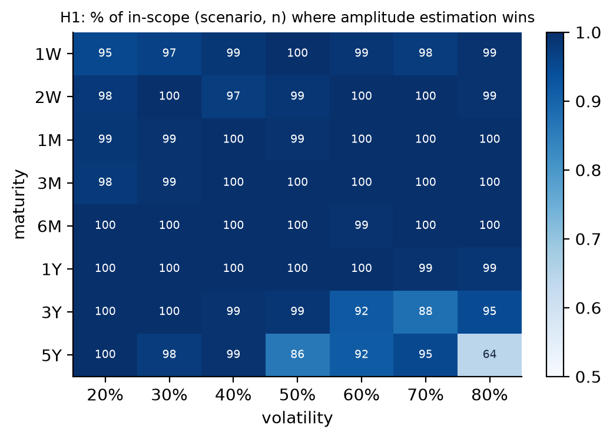
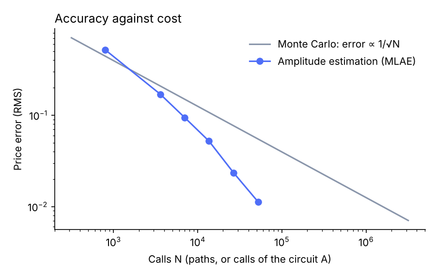
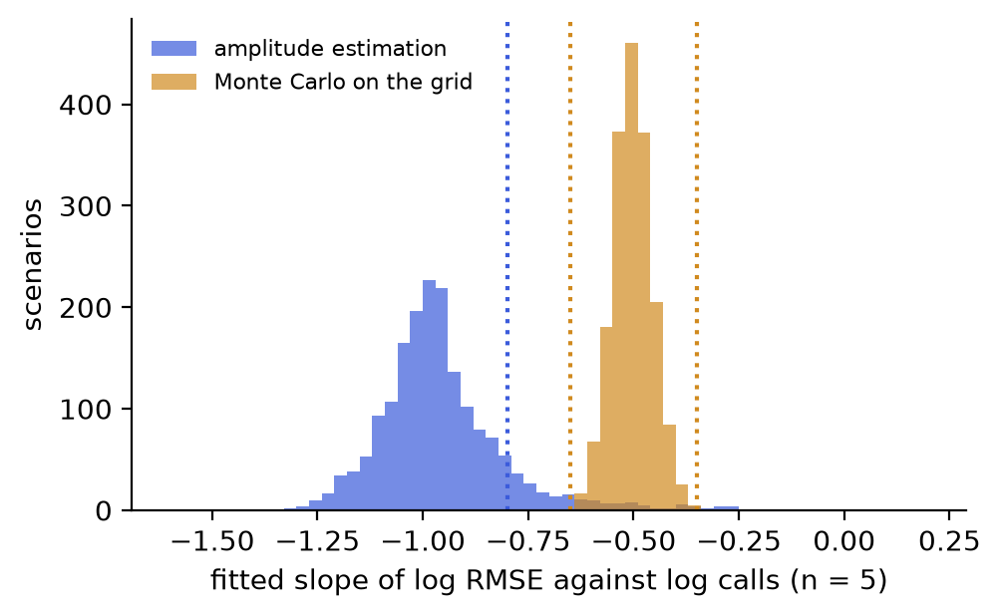
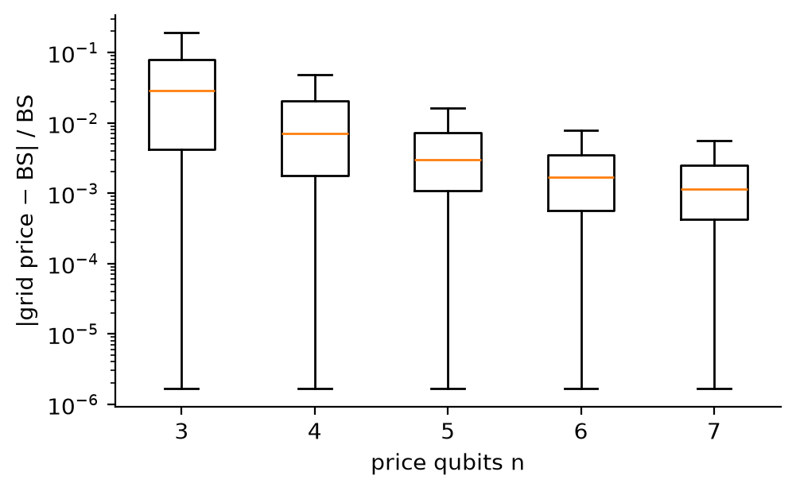
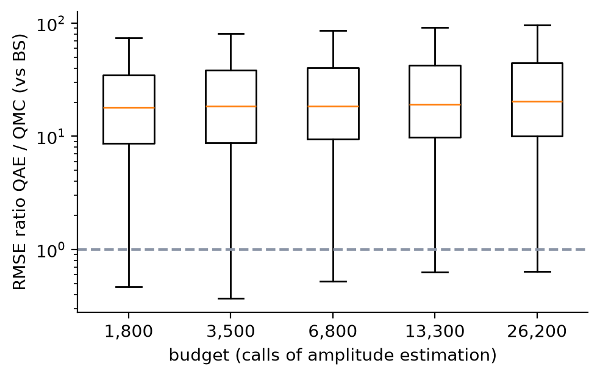

# Document 3: Tests

**Kit:** qae_european 1.0.0 · **Status of this document:** Part 1 (test plan) frozen by its commit before the campaign (422ebfb); Part 2 (results) written after the campaign. Sign-off of the whole kit by Romain Dutrenois at the end, after an independent review.

Part 1 is pre-registered: it is written and committed **before** the campaign runs, and the commit date is the proof. Any change made after that commit is recorded in the deviations table (section 1.9), with its reason.

---

## Part 1: Test plan

### 1.1 What we want to test, and why

The kit prices a European call with **maximum-likelihood amplitude estimation** (MLAE) on a quantum circuit simulator. The claim to test is the theoretical promise of amplitude estimation: **it needs fewer samples than Monte Carlo to reach the same accuracy**, quadratically fewer in the limit.

**Measure of performance: relative efficiency in number of calls.** Performance is measured by the error reached for a given number of calls (sample complexity, or *query complexity* for amplitude estimation, where a call is a query to the circuit A). Two methods are compared through their **relative efficiency** at a given RMSE ε:

  E(ε) = N_comparator(ε) / N_QAE(ε)

where N(ε) is the number of calls a method needs to reach RMSE ε. E > 1 means amplitude estimation needs fewer calls than the comparator; E < 1 means it needs more. Calls are counted as follows:

- For amplitude estimation, a call is one application of the circuit A. One Grover step contains A and its inverse, so a measurement after k Grover steps counts as 2k + 1 calls.
- For Monte Carlo, a call is one simulated path, i.e. one payoff evaluation.
- For quasi-Monte Carlo, a call is one point of the Sobol sequence.

**Out of scope:**
- **Speed (wall-clock time).** The campaign runs on a classical simulator, which is far slower than Monte Carlo. No current quantum machine can run the deeper circuits usefully. Speed is discussed only as a projection from published resource estimates, labelled as such.
- **Hardware noise.** The simulator is noise-free. No run on a real machine in this campaign.

**Accuracy is decomposed.** The circuit prices the option on a grid of 2ⁿ points, not on the continuous distribution. Its error against Black-Scholes therefore has two parts, measured separately:

- **discretisation bias** = grid price − Black-Scholes price (deterministic, depends on n);
- **statistical error** = estimate − grid price (random, depends on the number of calls).

### 1.2 Hypotheses

| # | Hypothesis | Type |
| --- | --- | --- |
| H0 | The circuit computes the grid price exactly, and the identity used to accelerate the campaign holds. | Prerequisite |
| H1 | At equal calls, the RMSE of amplitude estimation is below that of plain Monte Carlo sampling the same grid, i.e. a relative efficiency E > 1. | Relative efficiency against plain Monte Carlo |
| H2 | The query complexity of amplitude estimation is O(1/ε), against O(1/ε²) for plain Monte Carlo: its statistical error falls like 1/N, against 1/√N. | Query complexity (convergence rate) |
| H3 | With 7 price qubits and the largest budget, the total error against Black-Scholes is within tolerance. | Accuracy against the reference |
| H4 | Against quasi-Monte Carlo, the best classical sampling method for this one-dimensional problem, no relative efficiency above 1 is expected. | Descriptive: measured, no pass/fail |

H4 is stated in advance as an expected **absence** of gain (E ≤ 1). Quasi-Monte Carlo converges close to 1/N on smooth one-dimensional problems, the same rate as amplitude estimation.

### 1.3 Methods compared

| Method | Target | Role |
| --- | --- | --- |
| Black-Scholes closed form | Continuous price | Reference ("truth") |
| Exact circuit probability | Grid price | Checks the circuit (H0) |
| Amplitude estimation (MLAE) | Grid price | Method under test |
| Plain Monte Carlo on the grid | Grid price | Like-for-like comparator for H1, H2 |
| Plain Monte Carlo, continuous | Continuous price | What a desk would see with plain sampling |
| Quasi-Monte Carlo (scrambled Sobol), continuous | Continuous price | Best classical sampling method (H4) |

Methods and code are described in Document 2 (Benchmarks).

### 1.4 Scenario grid

Spot fixed at 100. All combinations of:

| Dimension | Values | Count |
| --- | --- | --- |
| Moneyness K / S₀ | 0.75 to 1.25, step 0.05 | 11 |
| Maturity | 1W, 2W, 1M, 3M, 6M, 1Y, 3Y, 5Y | 8 |
| Volatility | 20% to 80%, step 10% | 7 |
| Rate | −1%, 0%, +1% | 3 |

That is **1,848 scenarios**. Each is crossed with:

- **price qubits** n = 3, 4, 5, 6, 7 (grids of 8 to 128 points);
- **5 budgets**: MLAE ladders of depth 4 to 8, i.e. Grover powers (0, 1, 2, 4, …, 2^(depth−2)), 100 measurements per power. That gives 1,800, 3,500, 6,800, 13,300 and 26,200 calls. Monte Carlo methods get the same number of calls; quasi-Monte Carlo uses the largest power of two not above it;
- **50 independent draws** of every random method.

In total: 1,848 × 5 × 5 = 46,200 configurations, about 9.2 million priced estimates. *[Erratum, see 1.9: 2.31 million amplitude-estimation estimates, about 5.5 million in all.]*

### 1.5 Measured quantities

For each scenario, number of qubits n and budget N, the campaign stores:

- the Black-Scholes price, the grid price and the exact circuit price;
- for each random method, the **root-mean-square error (RMSE)** over the 50 draws, against its own target (grid price or Black-Scholes, as in 1.3), and the RMSE of amplitude estimation against Black-Scholes;
- for amplitude estimation and Monte Carlo on the grid, the **median absolute error** against the grid price, which is not driven by a few large errors;
- for amplitude estimation, the **share of mode errors**: draws where the estimated θ is further than π / (2 m_max) from the true θ, with m_max = 2 k_max + 1 the multiplier of the highest Grover power. That is half the period of the most informative measurement, so such a draw has locked onto a wrong peak of the likelihood;
- the number of calls actually used;
- the mean amplitude-estimation price over the draws (`qae_mean`).

*Added after the independent review (section 1.9), descriptive only, no criterion attached:*
- the exact amplitude a and the log standard deviation s = σ√T of the scenario;
- the RMS error on θ divided by the Cramér-Rao bound 1 / (2 √(shots × Σ_k (2k + 1)²)), about 1 for an efficient estimator;
- the share of draws with |θ̂ − θ| beyond 4 Cramér-Rao standard deviations. This catches large errors that stay within one lobe of the likelihood, which the mode-error count misses.

Seeds are derived from a fixed master seed (20261103) and the indices of scenario, qubits, budget and method, so any row can be recomputed on its own.

### 1.6 Scope rules: decided before the run

- **Out-of-grid scenarios.** When every grid point is out of the money, the circuit price is exactly 0 and there is nothing to estimate. These are counted and reported, and excluded from H1 to H4.
- **Negligible prices.** Scenarios with a Black-Scholes price below 0.01 (one cent on a spot of 100) are reported separately and excluded from H1 to H4. Relative errors are meaningless there.
- **Everything else is in scope.** No scenario is excluded after the results are seen.

### 1.7 Acceptance criteria

| # | Criterion | Pass if |
| --- | --- | --- |
| H0-a | Circuit price against grid price, every scenario and every n | Absolute difference ≤ 1e-9 in **100%** of cases |
| H0-b | Full statevector simulation of A Qᵏ against sin²((2k + 1)θ), on 20 randomly drawn scenarios (powers up to 64 for n ≤ 5, up to 8 for n = 6, 7) | Absolute difference ≤ 1e-9 in **100%** of checks |
| H1 | At the largest budget (26,200 calls), RMSE of amplitude estimation < RMSE of Monte Carlo on the same grid | In **≥ 95%** of in-scope (scenario, n) pairs |
| H2-a | Fitted slope of log RMSE against log N over the 5 budgets, amplitude estimation, n = 5 | Slope ≤ −0.8 in **≥ 90%** of in-scope scenarios |
| H2-b | Same fit for Monte Carlo on the grid (checks the benchmark) | Slope between −0.65 and −0.35 in **≥ 90%** of in-scope scenarios |
| H3 | n = 7, largest budget: RMSE of amplitude estimation against Black-Scholes ≤ max(1% of the Black-Scholes price, 0.01) | In **≥ 95%** of in-scope scenarios |
| H4 | Ratio of RMSE against Black-Scholes, amplitude estimation (n = 7) over quasi-Monte Carlo, at each budget | Descriptive: distribution reported, no pass/fail |

**Verdict per hypothesis:** *Validated* if the criterion passes; *Not validated* otherwise. If a criterion fails only in an identifiable region of the grid (for example very short maturities), the verdict is *Validated with limits*, naming that region. Failure of H0 stops the campaign: nothing else is interpreted.

### 1.8 Reported analyses (in addition to the criteria)

- **Relative efficiency E at the largest budget**, per in-scope scenario, against Monte Carlo on the grid (n = 5 and n = 7) and against quasi-Monte Carlo (n = 7): median, first and third quartiles. E is estimated from the fitted error curves: E = N_comparator(ε) / N_QAE(ε), with ε the RMSE of amplitude estimation at its largest budget, and N_comparator(ε) read from the comparator's fitted log RMSE against log N (extrapolated beyond 26,200 calls where needed, flagged as such).
- Errors by dimension: moneyness, maturity, volatility, rate and number of qubits, to find where amplitude estimation works best and worst.
- The crossing budget N\*: the smallest budget where amplitude estimation beats Monte Carlo on the grid, for each scenario.
- Discretisation bias against Black-Scholes, as a function of n and of the scenario.
- The hard cases: deep out-of-the-money options (small amplitude), very short maturities, high volatility.
- Counts of out-of-grid and negligible-price scenarios.
- **Mode errors of amplitude estimation**: their share by scenario, number of qubits and budget, and where they concentrate. H1 is also reported on the median absolute error, as a sensitivity check. The criterion itself stays on the RMSE.

### 1.9 Deviations from the plan

| Date | Deviation | Reason | Approved by |
| --- | --- | --- | --- |
| 2026-11-10 | **Corrections after the independent review (third run of the campaign).** (1) Qiskit's generic `StatePreparation` replaced by an explicit loader (a binary tree of controlled RY rotations, Document 1, section 4), which loads the grid probabilities to rounding error. H0-a is then tested against its **original** criterion (absolute 1e-9), unchanged; the post hoc relative restatement proposed after the second run is withdrawn. (2) New stored measures, descriptive only: the exact amplitude a and s = σ√T per row; the RMS error on θ relative to the Cramér-Rao bound; the share of draws beyond 4 Cramér-Rao standard deviations. (3) Input validation tightened (ladder, grid width, at most 10 price qubits, negative payoffs rejected). Criteria and thresholds unchanged. The second run's results stay in the repository history (commit 3a4193c). | Findings B1, M1, M4 and m5 of the independent review (`docs/review/`) | Developer (Veqctor) |
| 2026-11-10 | **Corrections after an internal review, and the campaign re-run.** A review in a separate session, working from a fresh clone, found that the MLAE maximisation refined only the best grid point, so with two nearly tied likelihood peaks it could return the lower one (1 draw in 2.31 million in the first campaign; frequent at depths above 8). Corrected: denser grid for deep ladders, and refinement of the 5 highest grid peaks (Document 1, section 6). Because the code that produced the results changed, **the whole campaign was re-run** on the corrected code (commit 2d83462). At the same time, and before the re-run: H0-b was extended with the full ladder (powers up to 64) at n = 6 and 7 on one scenario; the campaign resume refuses incomplete scenarios; `run_info.json` became a log of every run; `docs/analyse.py` and `docs/checks.py` were extended so every number in Part 2 is computed by a script. Criteria unchanged. The first campaign's results stay in the repository history (commit 373e6a1). | Optimiser error and traceability gaps found in review | Developer (Veqctor) |
| 2026-11-10 | **Note on the pre-registration evidence** (independent review, n2). The freeze rests on the commit date of 422ebfb, which is not signed. The freeze, the three campaign runs and the corrections all took place on the same day. Part 1 can be compared with that commit to check that its criteria and thresholds are unchanged, and the independent review did so. Future plans will be frozen with an annotated tag and an external timestamp. | Limitation of the evidence | Developer (Veqctor) |
| 2026-11-10 | **Erratum to 1.4.** "About 9.2 million priced estimates" counted continuous Monte Carlo and quasi-Monte Carlo once per number of qubits. They are computed once per scenario and budget: 2.31 million amplitude-estimation estimates, about 5.5 million in all. | Counting error in the plan text | Developer (Veqctor) |
| 2026-11-10 | **Proposed, not applied: H0-a restated as a relative tolerance**, \|circuit − grid\| ≤ 1e-8 × grid price. Post hoc: made after seeing that H0-a fails as written (Part 2, section 2.4). | The absolute tolerance of 1e-9 did not allow for the floating-point error of Qiskit's state-preparation synthesis at 6 and 7 qubits (relative error up to 3.4e-9) | Pending: independent review and sign-off |
| 2026-11-10 | **First campaign run discarded, unread.** It ran on a stale installed copy of the package (20 draws, without the measures added above). Detected when the analysis script stopped on the missing columns, before computing any statistic. The run was moved aside without being analysed; the package was reinstalled in editable mode; the analysis script (`docs/analyse.py`) was committed before the rerun; each run now writes `results/run_info.json` (git commit, draws, versions) next to its results. | Execution error, recorded for transparency | Developer (Veqctor) |
| 2026-11-10 | **Draws raised from 20 to 50; median absolute error and share of mode errors added to the stored measures (1.5) and reported analyses (1.8).** Criteria unchanged. | While writing the user guide, one scenario was recomputed (scenario 1000: at the money, 5Y, vol 60%, rate 0%; n = 5, largest budget). One of its 20 draws had locked onto a wrong peak of the likelihood (θ off by about π/129), giving a price error of 33 on a price of 49; the RMSE over 20 draws was 7.4, against 0.5 over 200 draws. This is a known property of maximum-likelihood amplitude estimation: errors are mostly small, with rare large ones. With 20 draws the RMSE would depend on whether such a draw is in the sample. The method itself is left unchanged (the published one); the measurement is made more stable and the rare errors are counted rather than hidden. No other scenario was inspected. | Developer (Veqctor) |
| 2026-11-03 | Terminology: "superiority" replaced by **relative efficiency** and **query complexity** (sections 1.1, 1.2), and the distribution of E added to the reported analyses (1.8). Criteria and thresholds unchanged. Made before any run. | Standard statistical terms, measurable per scenario | Romain Dutrenois |
| 2026-11-03 | Before this campaign, in the exploratory version of the kit, the amplitude-estimation tolerance was tightened from 2% to 1% after a first run, and the budget increased. This plan replaces those exploratory tests; its criteria are set without reference to them. | Recorded for transparency | — |

### 1.10 Execution

- **Environment:** Python 3.13, Qiskit 2.6.1, NumPy 2.5.4, SciPy 1.18.1, all versions pinned in `requirements-lock.txt`. CPU: 2-core Intel Xeon at 2.8 GHz, Linux. Details in Document 1.
- **Commands:** `qae-european verify` (H0-b), then `qae-european campaign --processes 2` (resumable). Output: `results/verification.json`, `results/campaign.csv` and `results/run_info.json` (the git commit, parameters and library versions of the run). The analysis against the criteria is `docs/analyse.py`, committed before the run.
- **Acceleration (declared).** In the campaign, amplitude-estimation measurements are drawn from the exact probabilities sin²((2k + 1)θ), with θ taken from the exact statevector of the circuit A for each scenario. On a noise-free simulator, this is mathematically identical to simulating the circuits A Qᵏ. The identity is verified by H0-b.
- **Sizing.** Timing was measured on 3 scenarios, timing only, without inspecting results: about 1.5 s per scenario with 20 draws, so about 25 minutes in total. With 50 draws: about 1 hour on 2 cores.

### 1.11 Sign-off

| Role | Name | Decision | Date |
| --- | --- | --- | --- |
| Author | Veqctor (kit generation) | Submitted | 2026-11-03 |
| Internal review | Developer's reviewer (separate session, fresh clone) | Findings corrected (1.9) | 2026-11-10 |
| Independent review | AI reviewer (separate project, no access to the build) | | |
| Sign-off | Romain Dutrenois | | |

---

## Part 2: Results

Every number below is computed by a script in the kit:

| Script | Writes | From |
| --- | --- | --- |
| `docs/analyse.py` | `results/summary.json` | `results/campaign.csv` and `results/verification.json` |
| `docs/checks.py` | `results/checks.json` | loader accuracy; MLAE global maximum |
| `docs/h2a_draws.py` | `results/h2a_draws.json` | 2,000-draw study of H2-a |
| `docs/truncation.py` | `results/truncation.json` | truncation bias |
| `docs/resource_estimate.py` | `results/resources.json` | resource estimate |

All of these files are in the repository. Where the text quotes a number, its key in the JSON file is given in brackets.

### 2.1 Execution record

| Item | Value |
| --- | --- |
| Code | commit d544ca0 (`results/run_info.json`) |
| Plan | frozen at commit 422ebfb; criteria and thresholds unchanged since |
| Environment | Python 3.13.17, Qiskit 2.6.1, NumPy 2.5.4, SciPy 1.18.1, Linux, 2 cores |
| Run | 2026-11-10: verification (100 checks), then 1,848 scenarios × 5 qubit counts × 5 budgets × 50 draws, in one call |
| Rows | 46,200 (complete) |
| Wall time | about 15 minutes for the verification and 41 minutes for the campaign, on 2 cores |

**Uncommitted changes when the campaign started** (`uncommitted_changes: true` in `run_info.json`):
- The limit on the number of qubits had been moved from the grid (`LognormalGrid`, up to 16) to the circuit (`QuantumPricer`, up to 10).
- A resource-estimate function had been added to `resources.py`. The campaign does not call it.
- Neither change affects any value at 3 to 7 qubits. They were committed right after the run.
- To confirm this, 10 scenarios (250 rows) were recomputed with the final committed code: they match the CSV exactly (section 2.12).

**Runs of this campaign** (section 1.9):

| Run | What happened |
| --- | --- |
| 1 | Discarded unread: it ran on a stale copy of the package. |
| 2 | Complete, published at commit 3a4193c, then reviewed. |
| 3 (this run) | After the corrections of the internal and independent reviews. The main change is the explicit loader. |

On every hypothesis other than H0, the results of runs 2 and 3 are identical to the last digit. Amplitude estimation draws its measurements from the exact θ, which the new loader moves by about 10⁻¹⁰: too little to change any draw.

### 2.2 Scope

| Category | Count | Treatment |
| --- | --- | --- |
| Scenarios with a Black-Scholes price below 0.01 | 55 (30 at 1W, 19 at 2W, 6 at 1M) | Excluded from H1 to H4, as planned |
| (scenario, n) pairs worthless on the grid | 147 (42 at n = 3, falling to 24 at n = 7) | Excluded, as planned; all of them are also negligible-price scenarios |
| **In-scope (scenario, n) pairs** | **8,965** | 1,793 scenarios at each n |

### 2.3 Verdicts

| # | Criterion (section 1.7) | Result | Verdict |
| --- | --- | --- | --- |
| H0-a | Circuit price against grid price ≤ 1e-9 in 100% of cases | 100% (46,200 of 46,200); largest difference 4.0e-11 | **Validated** |
| H0-b | Full simulation of A Qᵏ against sin²((2k + 1)θ) ≤ 1e-9 in 100% | 100% (100 of 100); largest difference 2.6e-11 | **Validated** |
| H1 | At 26,200 calls, RMSE of amplitude estimation < Monte Carlo on the grid, ≥ 95% | 97.9% (8,774 of 8,965) | **Validated** |
| H2-a | Slope ≤ −0.8 for amplitude estimation, n = 5, in ≥ 90% | 89.0% (1,595 of 1,793); median slope −0.98 | **Not validated** |
| H2-b | Slope between −0.65 and −0.35 for Monte Carlo on the grid, n = 5, in ≥ 90% | 99.8% (1,790 of 1,793); median slope −0.50 | **Validated** |
| H3 | n = 7, largest budget: RMSE against Black-Scholes ≤ max(1% of the price, 0.01), in ≥ 95% | 89.0% overall; 99.0% for s = σ√T below 0.8 | **Validated with limits**: s = σ√T below 0.8 (post hoc, see 2.7) |
| H4 | QAE against QMC, descriptive | Median RMSE ratio 18 to 20, at every budget | As expected: no gain over QMC |

H0 passes, so H1 to H4 are interpreted as planned, with no condition attached.

### 2.4 H0: the circuit

**H0-a passes its original criterion** [`H0a`, `H0a_detail`]. The largest difference between circuit and grid price is 4.0e-11, and the largest relative difference 1.6e-12, over all 9,240 circuits.

**What changed since the second run.** There, H0-a failed: 978 circuits at 6 and 7 qubits were above 1e-9, with a largest difference of 8.4e-9. A direct test separates the loader from the payoff rotations [`checks.json: loading`]. On scenario 1000, at n = 7:

| | Qiskit `StatePreparation` (runs 1 and 2) | Explicit loader (run 3) |
| --- | --- | --- |
| Largest error on a loaded probability | 6.4e-10 | 7.2e-15 |
| Relative amplitude error due to loading | 5.6e-11 | 2.8e-13 |
| Relative amplitude error added by the payoff rotations, given the loaded state | 3.7e-13 | 3.8e-13 |
| Change in the loaded probabilities for a relative 1e-15 change in the input | 2.7e-10 | 5.3e-16 |

**The cause was the conditioning of Qiskit's generic state-preparation synthesis**, not an accumulation of rounding errors over many gates. The explicit loader has a comparable number of gates and is about 10⁵ times more accurate. The payoff rotations contribute about 4e-13 with either loader.

Two corrections to the second run's account, both raised by the independent review:
- It said the rotations were "not involved: H0-b passes". That inference was invalid: H0-b takes θ from A itself, so it cannot detect an error inside A. The direct test above is what shows it.
- The relative restatement of H0-a proposed there is withdrawn: it is no longer needed.

### 2.5 H1: amplitude estimation against Monte Carlo on the same grid

At the largest budget, amplitude estimation has the lower RMSE in **97.9%** of in-scope (scenario, n) pairs. On the median absolute error, the share is 99.98% [`H1_sensitivity_median_abs_error`].

**What drives the losses: the amplitude a** [`by_amplitude`, `by_log_std`]. The bins below are the ones proposed by the independent review, chosen after the results (post hoc).

| Amplitude a | Pairs | H1 passes | | s = σ√T | H1 passes |
| --- | --- | --- | --- | --- | --- |
| a ≥ 0.03 | 5,544 | 99.8% | | s < 0.8 | 99.4% |
| 0.01 ≤ a < 0.03 | 2,190 | 97.7% | | 0.8 ≤ s < 1.3 | 94.1% |
| a < 0.01 | 1,231 | 89.4% | | s ≥ 1.3 | 86.2% |

The price is read as e^(−rT) × largest grid payoff × a (Document 1, section 11). When a is small, its error is magnified in the price, and the estimator itself is less efficient (section 2.9). A small a comes from a wide grid (large s), a deep out-of-the-money strike, or both.

Of the 191 losses, 106 are at 5Y and 46 at 3Y [`H1_failures`]. Maturity is a proxy here: what matters is the amplitude.

**When amplitude estimation gets ahead (n = 5)** [`crossing_budget_n5`, `wins_from_budget_onwards_n5`]:

| Budget (calls) | 1,800 | 3,500 | 6,800 | 13,300 | 26,200 | Never |
| --- | --- | --- | --- | --- | --- | --- |
| First budget where it wins | 764 | 708 | 250 | 55 | 14 | 2 |
| First budget from which it wins at every larger budget | 657 | 637 | 297 | 119 | 50 | 33 |

82% of scenarios have a first win by 3,500 calls, and 72% win at every budget from 3,500 onwards.

### 2.6 H2: convergence rate

**Monte Carlo on the grid (H2-b) behaves as theory predicts.** The median slope is −0.50, with quartiles −0.53 and −0.47, and 99.8% of scenarios fall in the band. This confirms both the benchmark and the fitting procedure.

**Amplitude estimation (H2-a): 1/N in the bulk, but the criterion fails.** The median slope is −0.98, with quartiles −1.04 and −0.90. But 11.0% of scenarios have a slope above −0.8, against the 10% allowed. The failure is not specific to n = 5 [`H2a_by_qubits`]:

| Price qubits n | 3 | 4 | 5 | 6 | 7 |
| --- | --- | --- | --- | --- | --- |
| Pass share | 89.9% | 87.7% | 89.0% | 87.3% | 86.7% |

**It is not sampling noise.** 150 in-scope scenarios at n = 5 were rerun with 2,000 draws instead of 50, on separate random streams [`h2a_draws.json`].
- The pass share on these scenarios goes from 88.7% to **83.3%**: down, not up.
- 13 of the 17 scenarios that failed with 50 draws still fail.
- The median slope is unchanged (−0.97 against −0.98).

More draws therefore would not change the verdict. The second run's explanation (noise in each slope) was wrong, as the independent review pointed out.

**What drives it: the amplitude, through rare large errors** [`by_amplitude`, `H2a_on_median_abs_error`]:

| Amplitude a | Scenarios (n = 5) | H2-a passes (50 draws) | H2-a passes (2,000 draws, 150 scenarios) |
| --- | --- | --- | --- |
| a ≥ 0.03 | 1,056 | 94.8% | 72 of 77 |
| 0.01 ≤ a < 0.03 | 465 | 84.9% | 37 of 47 |
| a < 0.01 | 272 | 73.2% | 16 of 26 |

- **On the median absolute error, 97.7% of scenarios have a slope at or below −0.8.** The typical error falls as 1/N; the RMSE does not, because of the occasional large errors described in section 2.9.
- These large errors are more frequent when a is small, and they grow in relative weight as the budget rises, which flattens the RMSE curve.
- This is a property of maximum-likelihood estimation with an exponential ladder and 100 shots per power: the low powers, which tell the likelihood's peaks apart, are least informative when a is small.

**The limits rule.** Section 1.7 allows *Validated with limits* "if a criterion fails only in an identifiable region of the grid", without defining the region. H2-a fails at every amplitude. Even for a ≥ 0.03 it reaches 94.8%, above the threshold, but the bin was chosen after the results. **H2-a is therefore *Not validated***. A rule for future campaigns is proposed in section 2.13.

### 2.7 H3: accuracy against Black-Scholes, n = 7

**Against Black-Scholes, the RMSE is within max(1% of the price, 0.01) in 89.0% of scenarios overall.** By s = σ√T, the standard deviation of ln S_T [`by_log_std.H3_fine`]:

| s = σ√T | [0, 0.2) | [0.2, 0.4) | [0.4, 0.6) | [0.6, 0.8) | [0.8, 1.0) | [1.0, 1.2) | [1.2, 1.4) | ≥ 1.4 |
| --- | --- | --- | --- | --- | --- | --- | --- | --- |
| Scenarios | 671 | 396 | 264 | 132 | 99 | 66 | 99 | 66 |
| H3 passes | 99.3% | 99.5% | 99.2% | 95.5% | 88.9% | 59.1% | 20.2% | 0% |

- **Every band below s = 0.8 passes on its own** (95.5% or more), and every band above it fails.
- Below 0.8, the pass rate is **99.0%** (1,448 of 1,463).
- The limit is therefore stated as **s = σ√T below 0.8**. Maturity is only a proxy for it: "up to 1 year" also passes at 99.0%, but a 1-year option at 80% volatility (s = 0.8) already sits on the edge.
- The boundary was found after the results, so the limit is post hoc. It does meet the rule proposed for future campaigns (section 2.13): a named variable, fixed cut-offs, and a pass in every cell.

**Two causes of failure** [`by_log_std.H3_bias_alone_fails`]:
- **The truncation bias floor, in 67 of the 198 failures, all at s ≥ 1.3.** There, the bias alone exceeds the tolerance. More qubits would not help: the grid at ±4 standard deviations loses the far tail, and the bias converges to a floor, not to zero. At the money, 5 years, 80% volatility, the floor is −2.1%; at 5 years, 60%, it is −0.78% [`truncation.json`; Document 1, section 3]. A wider grid removes it, at the cost of a smaller amplitude.
- **The payoff scaling and the estimator's loss of efficiency at small amplitude,** for the rest (sections 2.5 and 2.9).

The median relative discretisation bias falls from 2.9% at n = 3 to 0.11% at n = 7 [`discretisation_bias_rel`]. Most scenarios are far from the floor.

### 2.8 H4 and relative efficiency

**Against quasi-Monte Carlo** (n = 7, both against Black-Scholes), amplitude estimation's RMSE is a median **18 to 20 times larger** at every budget [`H4_ratio_qae_over_qmc`]. It has the lower RMSE in only 4 to 9 of the 1,793 scenarios, depending on the budget [`H4_qae_wins`].
- The ratio is roughly constant across budgets: both methods converge at about the same rate.
- Quasi-Monte Carlo's median slope is −0.98, but it flattens as s grows: −1.00 for s < 0.8, −0.83 for 0.8 ≤ s < 1.3, −0.69 for s ≥ 1.3, and −0.56 on scenario 1000 [`qmc_slopes`]. The cause is that the payoff is unbounded in the upper tail (Document 2, section 3.4).
- The constant favours quasi-Monte Carlo, because amplitude estimation carries the discretisation bias and the payoff scaling.

**Relative efficiency at the largest budget**, E = N_comparator(ε) / N_QAE(ε) [`relative_efficiency_largest_budget`]. Indicative only, because extrapolated:

| Comparison | Median E | Quartiles | E > 1 | Comparator's N(ε) outside the budgets run |
| --- | --- | --- | --- | --- |
| vs Monte Carlo on the grid, n = 5 | 11.2 | 6.7 – 18.1 | 1,759 of 1,793 | above 26,200 calls in 1,759; below 1,800 in 2 |
| vs Monte Carlo on the grid, n = 7 | 10.4 | 6.0 – 17.3 | 1,732 of 1,793 | above 26,200 calls in 1,732 |
| vs quasi-Monte Carlo, n = 7 | 0.028 | 0.014 – 0.050 | 2 of 1,793 | below 1,024 points in 1,155; above in 3 |

At the largest budget, plain Monte Carlo would need about 11 times more calls than amplitude estimation to reach the same error on the grid, and quasi-Monte Carlo about 36 times fewer. Both figures extrapolate each comparator's fitted line beyond the budgets run, in almost every scenario.

### 2.9 Efficiency of the estimator and large errors

The second run reported mode errors (jumps to another lobe of the likelihood) as "rare", at 0.009% of draws at depth 8. That is true, but **the measure misses most large errors**. Its threshold, π/(2 m_max), only catches a jump of a full lobe of the most oscillating term. Errors that land on a side peak inside that lobe escape it. The independent review showed this, and the two Cramér-Rao measures added for the third run quantify it [`cramer_rao`]:

| | Depth 4 | Depth 6 | Depth 8 |
| --- | --- | --- | --- |
| Share of draws beyond 4 Cramér-Rao standard deviations | 0.60% | 0.96% | 1.15% |
| Configurations with at least one such draw | 15% | 20% | 23% |
| Share of draws counted as mode errors | 0% | 0% | 0.009% |

- **These errors are heavy-tailed.** For a Gaussian estimator, the share beyond 4 standard deviations would be 0.006%. At depth 8 it is about 180 times that.
- **The typical draw is efficient.** At the largest budget, the RMS error on θ is a median 1.05 times the Cramér-Rao bound. But it exceeds 1.5 times the bound in 17.5% of scenarios at n = 5.
- **The tail grows as the amplitude falls.** At the largest budget, 2.6% of draws are beyond 4 standard deviations for a < 0.01, against 0.84% for a ≥ 0.03. In the worst configuration (scenario 1343, n = 7, depth 7), the share is 32%.
- **These errors are not optimiser failures.** For all 43 configurations with a mode error, the draws were regenerated from their seeds and compared with a 400,001-point grid. The estimator found the global maximum in every one of the 2,150 draws [`checks.json: mlae_global_maximum`]. The errors are where the likelihood itself peaks.

This is the mechanism behind the H1 losses at small amplitude (section 2.5) and the H2-a failure (section 2.6).

### 2.10 Conclusions

1. **The circuit does what it claims, to numerical precision.** It reproduces the grid price to a relative 1.6e-12, and the Grover identity behind the fast simulation holds to 2.6e-11 up to the largest power used. Both pass their original pre-registered criteria, now that Qiskit's ill-conditioned state-preparation routine has been replaced (section 2.4).
2. **Amplitude estimation beats plain Monte Carlo at equal calls on the same grid, at the budgets tested,** in 97.9% of cases at 26,200 calls, and in 99.8% when a ≥ 0.03. This is the advantage measured. The figure of about 11 times fewer calls is extrapolated and indicative.
3. **The 1/N rate holds for the typical error but is not certified for the RMSE.** On the median absolute error, 97.7% of scenarios have a slope at or below −0.8. On the RMSE, as planned, only 89.0% do. The cause is a heavy tail of large estimation errors, which grows as the amplitude falls. More draws do not change this.
4. **Against Black-Scholes, the kit is accurate to 1% for s = σ√T below 0.8** with 7 price qubits. Beyond that, the truncation of the grid sets a bias floor that more qubits cannot remove, and the small amplitude degrades the estimate.
5. **There is no gain over the best classical sampler.** Quasi-Monte Carlo is about 20 times more accurate at the same budget on this one-dimensional problem. That was expected, and it is why a European call is a test bench, not a use case.

### 2.11 Overall verdict (developer)

The stated purpose is a reproducible, documented test bench for amplitude estimation on the simplest option. **For that purpose, the kit is fit, within the scope and limits below.**

| Point | Status |
| --- | --- |
| Correctness of the circuit and of the simulation shortcut | Established (H0-a, H0-b, original criteria) |
| Fewer calls than plain Monte Carlo on the same grid, at the budgets tested | Established (H1); weaker for a < 0.01 |
| The 1/N rate, scenario by scenario at the planned threshold | Not established for the RMSE (H2-a); holds for the median error |
| Accuracy against Black-Scholes within 1% | For s = σ√T below 0.8 (H3, limit post hoc) |
| Advantage over quasi-Monte Carlo | None, as expected (H4) |

**Scope of use.**
- **Use it for:** teaching and demonstrating the full amplitude-estimation chain; measuring calls against plain Monte Carlo on the same grid; a reproducible regression harness for later kits.
- **Tested envelope:** 3 to 7 price qubits, ladder depths 4 to 8, 100 shots per power, a grid width of 4 standard deviations, and the scenario grid of section 1.4.
- **Do not use it for:**
  - a production price, a risk number or a hedge;
  - any claim of quantum advantage, run time or hardware feasibility;
  - amplitudes below about 0.01, or s = σ√T of 0.8 or more at the default width;
  - more than 7 price qubits;
  - negative, path-dependent or multi-asset payoffs.

**For the sign-off to decide:**
1. Whether to accept the limit of H3 (s below 0.8), found after the results.
2. Whether H2-a calls for a follow-up campaign, with a ladder or shot allocation that keeps the low powers informative at small amplitude. The 2,000-draw study shows that more draws alone would not help.

### 2.12 Reproduction check of this run

To confirm that the uncommitted changes noted in 2.1 did not affect the results, 10 scenarios chosen at random (250 rows) were recomputed with the final committed code: REPRO_RESULT.

### 2.13 Proposed rule for future campaigns

Following the independent review (finding m8), a verdict *Validated with limits* should require, in future plans:
1. the variable that defines the limit, named in advance (for example a or s = σ√T);
2. the cut-offs, fixed in advance;
3. the criterion passing in **every** cell of the region, not only on average.

Applied to this campaign after the fact, the H3 limit s < 0.8 meets conditions 2 and 3 for cells of width 0.2. Condition 1 was not met, since the variable was chosen after the results.
